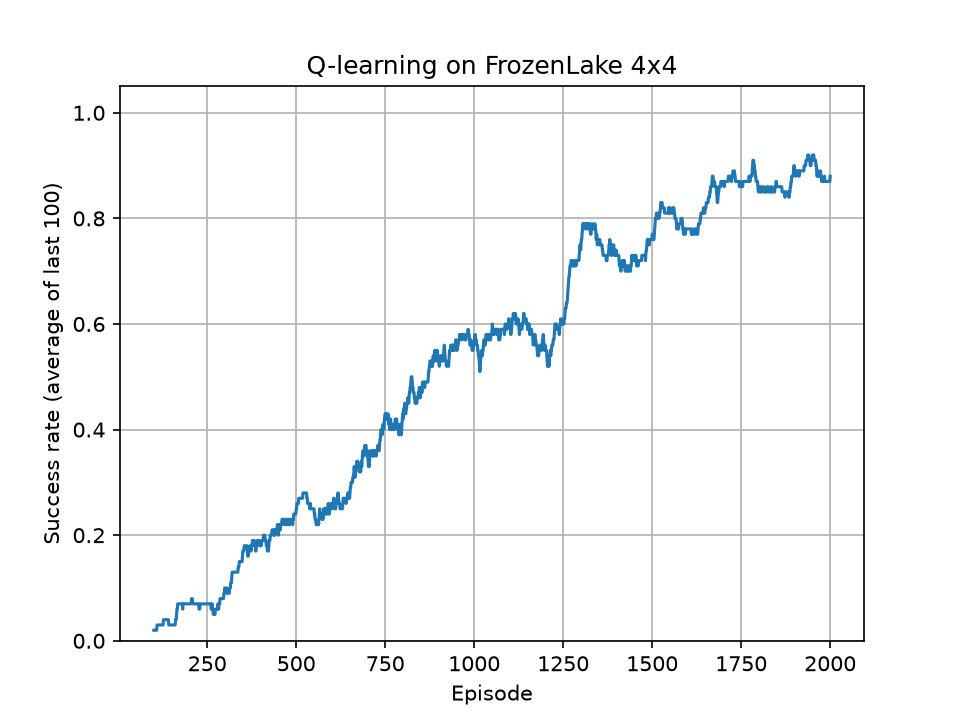
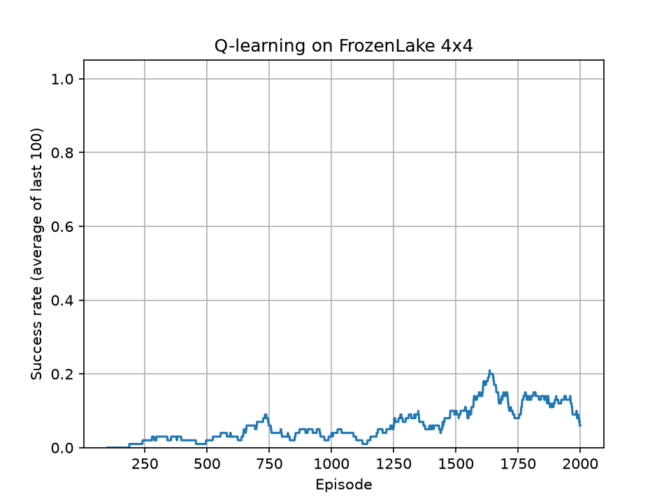
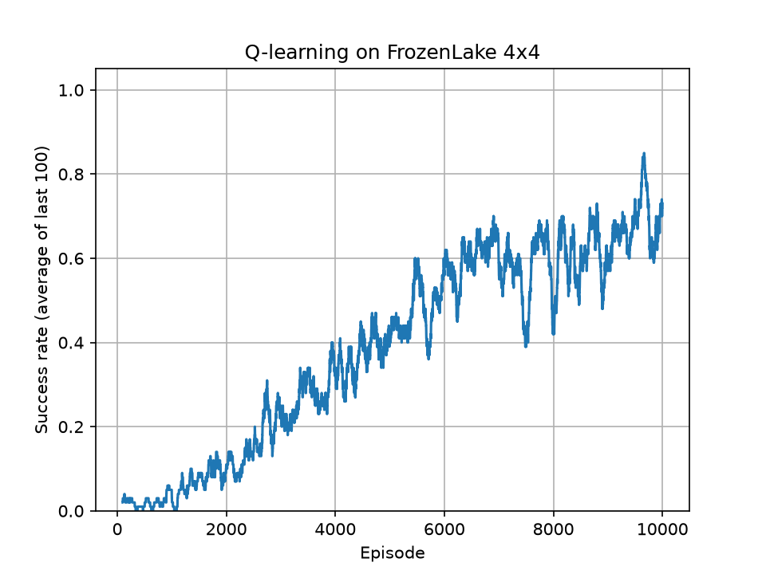

# Q-learning on FrozenLake

## Results

| Setup                       | Learning rate | Epsilon decay | Episodes | Test win rate |
| --------------------------- | ------------- | ------------- | -------- | ------------- |
| Normal ice                  | 0.8           | 0.999         | 2,000    | 100%          |
| Slippery ice, same settings | 0.8           | 0.999         | 2,000    | 8%            |
| Slippery ice, tuned         | 0.05          | 0.9995        | 10,000   | 71%           |

Test win rate is measured over 100 games with no random exploring.

Normal ice:

Slippery ice, original settings:

Slippery ice, tuned settings:

## What I found

- On normal ice the agent learns the route and wins every time in testing.
- With slippery ice the same settings fail (8%). A high learning rate means that a slide essentially betrays its built up knowledge in turn leading to a higher % of failure.
- A much lower learning rate (0.05), slower exploration decay and 10,000 episodes reached 71%. 100% is unreachable as some slides are inevitable. 
- The training curves finish below the test win rate because the agent is still taking random exploratory moves during training.

## How to run it

pip install gymnasium numpy matplotlib
python frozenlake_qlearning.py
the settings can be varied at the top of the code and when code is run the graph is produced under the name learning_curve.png

## How this was built

I learned the idea of Q-learning from a TikTok tutorial series on building a reinforcement learning model. The final code was written with help from Claude. I ran the experiments, compared the configurations and wrote up the results.
